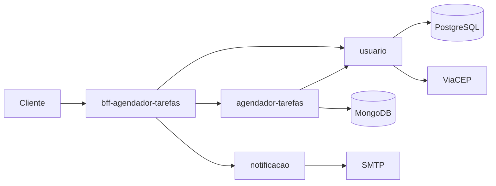

# Gabriel Barrilli

**Desenvolvedor Back-end Java** · São Luís, MA · Disponível para remoto

Trabalho com Java e Spring Boot construindo APIs REST e microsserviços. Hoje sou Engenheiro de IA na Arrais Tertulino Advocacia, onde desenvolvo sistemas internos, automações e agentes de IA para o escritório.

- Bacharel em Engenharia de Software — UNDB (2026)
- Experiência em sistemas para o setor público (SEAP-MA) e em SaaS para o mercado norte-americano, com time 100% em inglês
- Idiomas: português (nativo), inglês (avançado), espanhol (intermediário)

## Stack

| Área | Tecnologias |
| --- | --- |
| Back-end | Java 17, Spring Boot, Spring Security + JWT, Spring Data JPA, Spring Data MongoDB, OpenFeign |
| Bancos de dados | PostgreSQL, MongoDB |
| Infra e DevOps | Docker, Docker Compose, GitHub Actions |
| Front-end | React, TypeScript |
| IA | Claude Code, agentes e automações com LLMs |

## Projetos em destaque

### Agendador de Tarefas — arquitetura de microsserviços

O usuário cadastra tarefas e recebe um e-mail de lembrete antes do horário marcado.

| Serviço | Papel | Tecnologias |
| --- | --- | --- |
| [usuario](https://github.com/GabrielBarrilli/usuario) | Cadastro, login com JWT, endereços e telefones; consulta de CEP no ViaCEP | Spring Boot, PostgreSQL, Docker |
| [agendador-tarefas](https://github.com/GabrielBarrilli/agendador-tarefas) | CRUD de tarefas e busca por período | Spring Boot, MongoDB, OpenFeign |
| [notificacao](https://github.com/GabrielBarrilli/notificacao) | Envio de e-mails com templates HTML | Spring Mail, Thymeleaf |
| [bff-agendador-tarefas](https://github.com/GabrielBarrilli/bff-agendador-tarefas) | Backend for Frontend: porta de entrada única, documentação Swagger e job agendado que dispara os lembretes | Spring Boot, OpenFeign, Springdoc |

### [Livraria Barrilli](https://github.com/GabrielBarrilli/Desafio-Engineer-Fullstack)

Aplicação full stack de catálogo de livros: API REST em Spring Boot com PostgreSQL e front-end em React.

## Contato

[LinkedIn](https://www.linkedin.com/in/gabriel-barrilli) · gabrielbarrillidacruz@gmail.com
