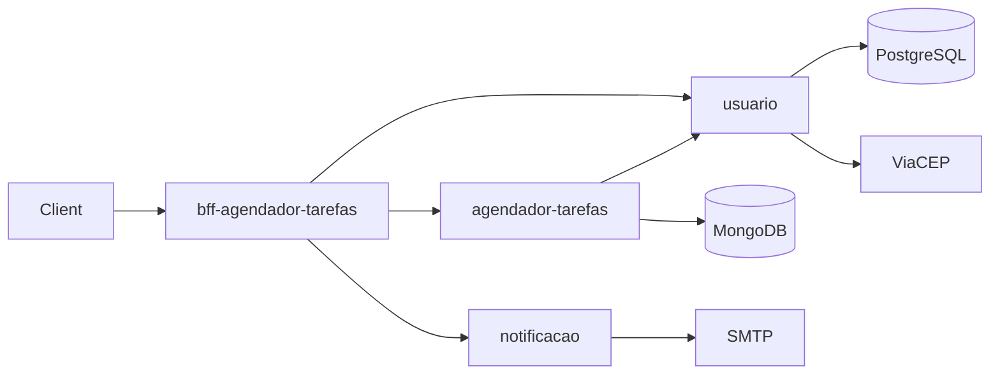

# Gabriel Barrilli

**Java Backend Developer** · São Luís, Brazil (UTC-3) · Open to remote and relocation

I build REST APIs and microservices with Java and Spring Boot. I currently work as an AI Engineer at a law firm (Arrais Tertulino Advocacia), building internal systems, automations and AI agents.

- B.Sc. in Software Engineering — UNDB (2026)
- Experience with public-sector systems (SEAP-MA, Brazil) and with a US SaaS product, working in a 100% English-speaking team
- Languages: Portuguese (native), English (advanced), Spanish (intermediate)

## Tech stack

| Area | Technologies |
| --- | --- |
| Backend | Java 17, Spring Boot, Spring Security + JWT, Spring Data JPA, Spring Data MongoDB, OpenFeign |
| Databases | PostgreSQL, MongoDB |
| DevOps | Docker, Docker Compose, GitHub Actions |
| Frontend | React, TypeScript |
| AI | Claude Code, LLM agents and automations |

## Featured project

### [Task Scheduler Platform](https://github.com/GabrielBarrilli/task-scheduler-platform) — Spring Boot microservices

Users sign up, create tasks and get an e-mail reminder before each task is due. Start at the [platform repository](https://github.com/GabrielBarrilli/task-scheduler-platform) for the architecture, how to run it and the roadmap.

| Service | Role | Stack |
| --- | --- | --- |
| [usuario](https://github.com/GabrielBarrilli/usuario) | Sign-up, JWT login, addresses and phones, ZIP code lookup (ViaCEP) | Spring Boot, PostgreSQL, Docker |
| [agendador-tarefas](https://github.com/GabrielBarrilli/agendador-tarefas) | Task CRUD and search by period | Spring Boot, MongoDB, OpenFeign |
| [notificacao](https://github.com/GabrielBarrilli/notificacao) | HTML e-mails from templates | Spring Mail, Thymeleaf |
| [bff-agendador-tarefas](https://github.com/GabrielBarrilli/bff-agendador-tarefas) | Backend for Frontend: single entry point, Swagger docs, scheduled reminder job | Spring Boot, OpenFeign, Springdoc |

### [Barrilli Bookstore](https://github.com/GabrielBarrilli/Desafio-Engineer-Fullstack)

Full-stack book catalog: Spring Boot REST API with PostgreSQL and a React frontend.

## Contact

[LinkedIn](https://www.linkedin.com/in/gabriel-barrilli) · gabrielbarrillidacruz@gmail.com
